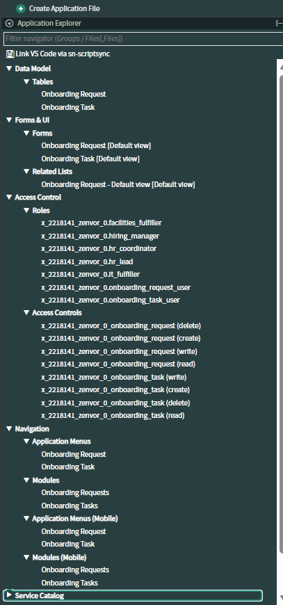
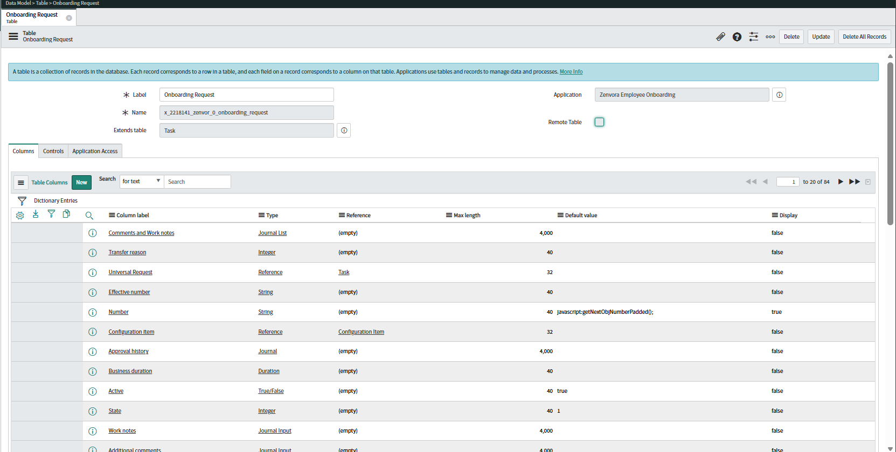
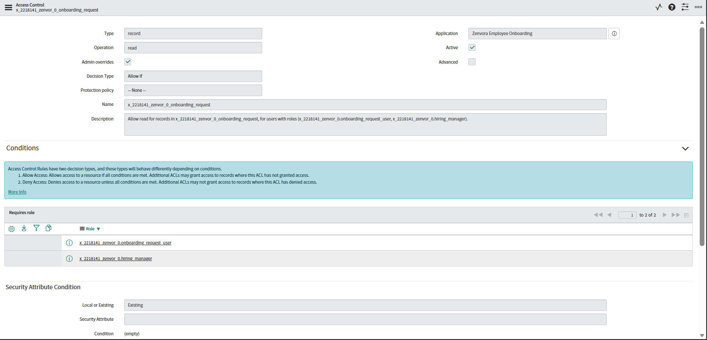
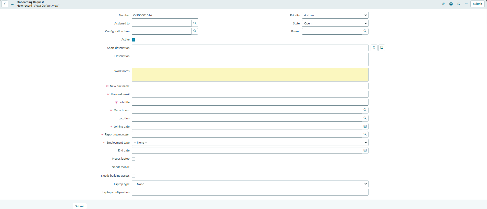
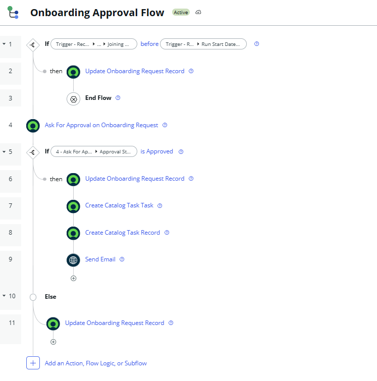
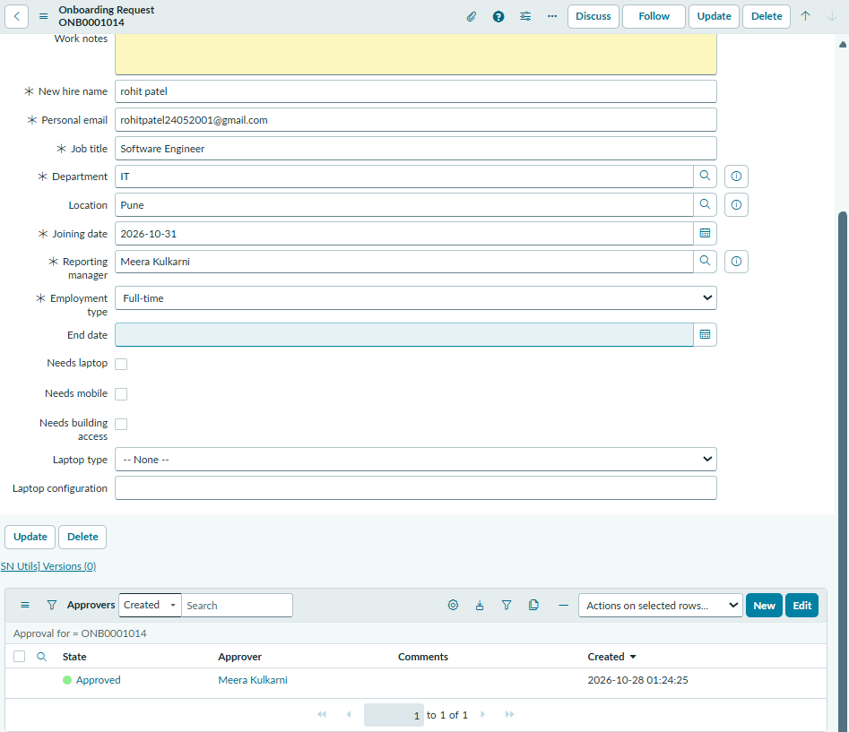
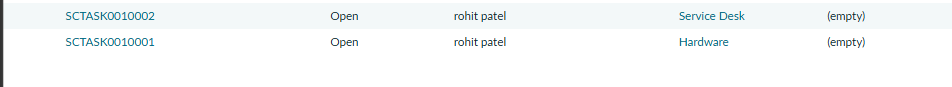
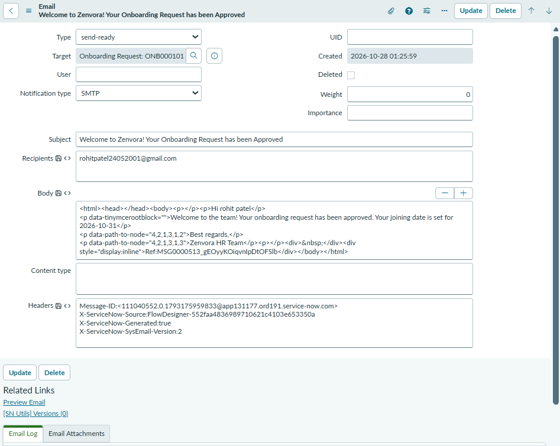
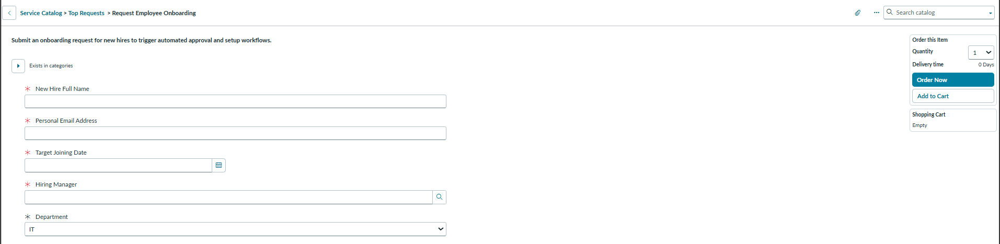

# Zenvora Employee Onboarding Automation

A no-code **ServiceNow scoped application** that automates new-hire onboarding: a manager submits a request, it is validated and sent for approval, and on approval the fulfilment tasks and a welcome email are generated automatically.

Built on a ServiceNow Personal Developer Instance from a business requirements document for a fictional IT services company (Zenvora Technologies, about 1,200 employees, offices in Pune and Mumbai).

---

## Table of contents

- [The problem](#the-problem)
- [What it does](#what-it-does)
- [How it works](#how-it-works)
- [Visual proof of work](#visual-proof-of-work)
- [Design decisions](#design-decisions)
- [Scope and future work](#scope-and-future-work)
- [Repository layout](#repository-layout)
- [Installation](#installation)
- [Author](#author)

---

## The problem

Onboarding was handled through email chains and spreadsheets. New hires started without laptops or system access, managers could not see progress, and HR spent hours chasing other teams. The goal is one system that runs from the moment a hire is confirmed.

**Constraint:** no custom code. Everything is built with standard platform features (Flow Designer, UI Policies, ACLs, Service Catalog) so an admin team can maintain it.

---

## What it does

- **Intake:** hiring managers raise an onboarding request through the Service Catalog.
- **Validation:** the flow checks the joining date and stops the request if the date is in the past.
- **Approval:** an approval request is sent to the manager, and the result is recorded on the request.
- **Fulfilment:** once approved, catalog tasks are created automatically for Hardware and Service Desk.
- **Communication:** a welcome email to the new hire is generated by the flow when the request is approved.
- **Rejection:** a rejected request is updated by a separate branch of the flow and no tasks are created.
- **Isolation:** everything lives in one scoped application, `x_2218141_zenvor_0`.

---

## How it works

```text
   Hiring manager submits request (Service Catalog)
                      |
                      v
        Onboarding Request record (ONB number)
                      |
                      v
           Onboarding Approval Flow
                      |
         Joining date in the past?
             yes |            | no
                 v            v
           Update record    Ask for approval
           and end flow          |
                          +------+------+
                          |             |
                      Approved       Rejected
                          |             |
                          v             v
                 Update record     Update record
                 Create catalog
                 tasks (Hardware,
                 Service Desk)
                 Send welcome email
```

---

## Visual proof of work

### 1. Studio workspace and application structure

The scoped application in ServiceNow Studio: two custom tables, forms, roles, access controls and navigation menus.



### 2. Data model

The `Onboarding Request` table extends the platform Task table, so it inherits number, state, assignment and approval fields.



### 3. Access control (ACL)

An access control rule on the onboarding request table, limited to the application's roles.



### 4. Request form

The form for an onboarding request, with the new hire's details, department, joining date, reporting manager, employment type and equipment needs.



### 5. Flow Designer logic

The **Onboarding Approval Flow**: a joining-date check, an approval step, then separate approved and rejected branches that update the record, create tasks and send an email.



### 6. Approved request

A request that has completed the approval step, showing the approval record with state **Approved**.



### 7. Fulfilment tasks

Catalog tasks created automatically after approval, assigned to the Hardware and Service Desk groups.



### 8. Email notification

The welcome email record generated by the flow, with the subject, recipient and message body filled in from the request.



### 9. Service Catalog intake

The catalog item where a manager submits a request, with mandatory fields and a joining-date field.



---

## Design decisions

- **Scoped application, not Global:** one container that can be exported and installed on another instance.
- **Custom tables extend Task:** reuses number, state, assignment group, due date and approval support instead of rebuilding them.
- **Flow Designer instead of scripts:** meets the no-code constraint and keeps the logic visible on one canvas.
- **Validation inside the flow:** the past-date check runs on the server, so it applies however the request is created.
- **Roles for access:** application roles (`hiring_manager`, `hr_coordinator`, `hr_lead`, `it_fulfiller`, `facilities_fulfiller`) with access rules tied to them.

---

## Scope and future work

This version covers setup, roles, data model, the intake form, approval, task creation and email notification.

Planned next:

- Fine-grained security so each team sees only its own tasks, and personal data is limited to HR
- Tasks split by HR, IT and Facilities, with equipment tasks created only when requested
- Deadline tracking, scheduled reminders and a searchable knowledge base
- Bulk CSV import with duplicate handling
- Reporting dashboard and weekly summary
- Packaging and automated tests

---

## Repository layout

- `main` branch: this README and the screenshots.
- `sn_instances/dev350797` branch: the application records exported from ServiceNow source control (tables, roles, catalog item, variables, UI policies, flow, ACLs).

---

## Installation

1. Sign in to a ServiceNow instance as a System Administrator.
2. Open classic Studio at `/$studio.do`.
3. Choose **Import From Source Control**.
4. Enter this repository's URL and your credentials, and select the branch `sn_instances/dev350797`.
5. Open Flow Designer and make sure **Onboarding Approval Flow** is active.
6. Create test users and add them to the application's roles to try the flow.

---

## Author

**Rohit Kumar Patel** - ServiceNow application developer (personal project)

Built with ServiceNow Studio, Flow Designer, Service Catalog, UI Policies and ACLs.
